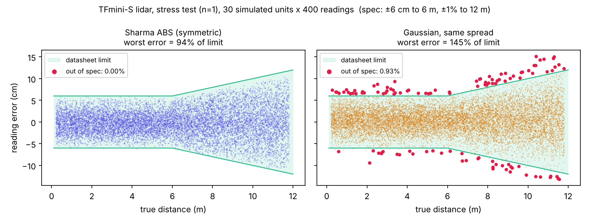
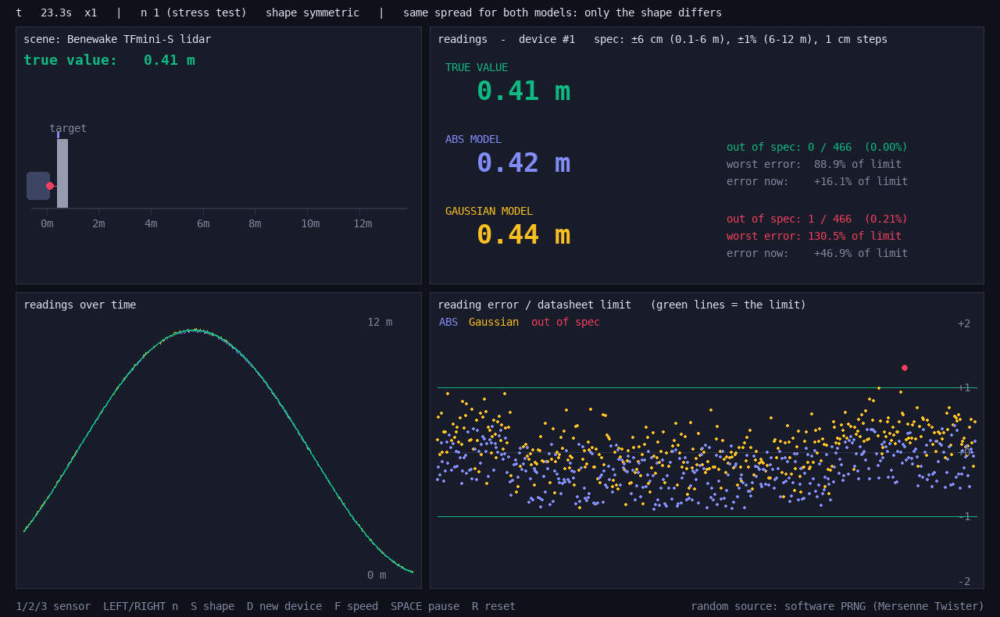
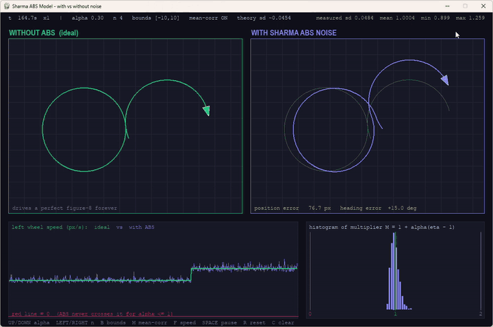
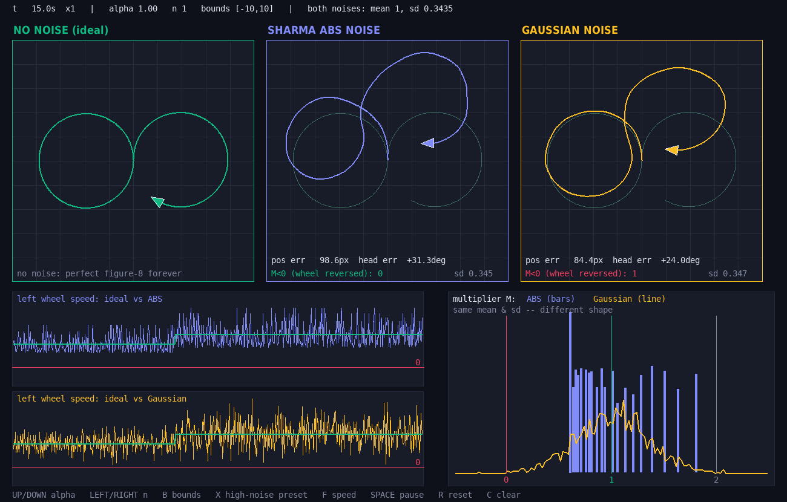
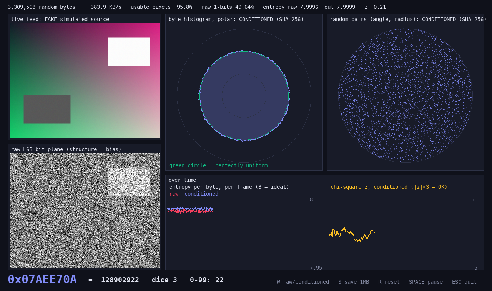

# Sharma ABS Model

The **Sharma Absolute Boundary Summation (ABS) Model** is a bounded, sign-preserving multiplicative noise factor for simulations and firmware testing. It needs only integer additions and one division, so it also runs on microcontrollers without an FPU.

📄 **Paper (revised, October 2026):** [`paper/sharma_abs.pdf`](paper/sharma_abs.pdf) — LaTeX source in [`paper/`](paper/). It supersedes the February 2026 draft.

## The model

$$\eta = \frac{N}{N + S}, \qquad N = n(|a| + |b|), \qquad S = \sum_{i=1}^{n} r_i$$

where $r_i$ are independent uniform integers on $[a, b]$ (the bounds) and $n$ is the complexity. The factor is applied as

$$v_{real} = v_{ideal}\,[1 + \alpha(\eta - 1)]$$

## What is proved (see the paper)

| Property | Result |
|---|---|
| Division by zero | Impossible whenever $b \ne 0$. $b = 0$ is rejected by the code. |
| Range | $\eta > 0$ always; $\eta \in [2/3,\ 2]$ for symmetric bounds $[-c, c]$ |
| Sign | For $0 \le \alpha \le 1$ the signal never changes sign (a 0–5 V reading never goes negative) |
| Amplitude | $\mathrm{sd}(\eta) \approx \sqrt{(1 + 1/c)/(12n)}$ — set by $n$ and $\alpha$, almost independent of the bounds |
| States | Exactly $n(b - a) + 1$ distinct values; the exact distribution is a finite sum |
| Bias | $\mathbb{E}[\eta] > 1$ (Jensen). Removed exactly with `normalize=True` |
| Relation to known methods | $\eta \approx 1/(1 + Z_n/\sqrt{12n})$, the reciprocal of a scaled Irwin–Hall variate |

**Choosing parameters:** pick $n$ for the shape (larger $n$ means less skew and bias), then set the amplitude with $\alpha \approx \sigma_{target}/\mathrm{sd}(\eta)$. Use the bounds only for resolution.

## Limitations

- **White noise only.** Values are independent, so it does not replace coherent noise such as Perlin noise.
- **Bounded, thin tails.** It is not suitable for heavy-tailed effects such as financial crashes.
- **Upper limits are not respected.** The multiplier can reach $1 + \alpha$, so clip explicitly if a rail matters.
- **Speed.** On a desktop CPU with an FPU it is slower than Box–Muller. Its advantage is integer-only arithmetic; microcontroller cycle counts have not been measured yet.

## Usage

### C (single header, `src/sharma_abs.h`)
```c
#include "src/sharma_abs.h"

sharma_abs_seed(12345);                      // seed once
float eta = compute_eta(-10, 10, 12);        // float path
float v   = apply_sharma_noise(100.0f, eta, 0.5f);

int32_t eq = compute_eta_q16(-10, 10, 12);   // integer-only path, Q16.16
int32_t vq = apply_sharma_noise_q16(1000, eq, 32768);  // alpha = 0.5 in Q16
```
It uses a seeded xorshift32 generator and unbiased integer sampling (Lemire). `*_r` variants take your own RNG state for ISR or thread use.

### Python (`src/sharma_abs.py`)
```python
import sys; sys.path.append("src")
from sharma_abs import SharmaABS

model = SharmaABS(-10, 10, 12, seed=1, normalize=True)   # normalize -> E[eta] = 1
noisy = model.generate_noisy_dataset([1.0, 2.0, 3.0], alpha=0.5)
print(model.exact_mean())   # exact E[eta] before normalisation
```

### CLI (`tools/abs_gen.py`)
```bash
python tools/abs_gen.py ideal.csv noisy.csv --min -10 --max 10 -n 12 -a 0.5 --col 1 --seed 1 --normalize --plot
```

### Web dashboard
Open `public/index.html` in a browser.

## Datasheet-calibrated sensor model (`src/sensor_model.py`)

Datasheets give accuracy as a hard limit, for example "±6 cm up to 6 m, ±1% up to 12 m". `SensorModel` takes those numbers directly and produces readings whose error **never exceeds the datasheet limit** (plus half a step of rounding), because the ABS factor is bounded.

```
reading = quantize( clip( true value + per-device error + per-sample noise ) )
```

- **Per-device error** (gain and offset) is drawn once per simulated unit. Call `new_device()` to get a different physical unit.
- **Per-sample noise** is drawn on every reading.
- **`n` sets the noise level.** Smaller n puts more readings near the limit. `n_for_sd(typical / max)` matches a datasheet that gives both a typical and a max error.
- **`shape` sets the skew.** `"symmetric"` uses narrow positive ABS bounds and suits "±" specs. `"skewed"` uses bounds around zero and suits errors that lean one way. Bounds control the *shape* of ABS noise, even though they barely affect its *size*.

```python
import sys; sys.path.append("src")
from sensor_model import SensorModel, tfmini_s, ds18b20, ina219b_current

lidar = tfmini_s(seed=1)                 # Benewake TFmini-S preset
lidar.read([0.5, 3.2, 9.8])              # readings in metres
lidar.new_device()                       # a different physical unit

custom = SensorModel(accuracy=(0.02, 0.1), resolution=0.01, limits=(0, 50))  # ±(2% of reading + 0.1)
```

**Presets.** Numbers are from the manufacturers' datasheets or product pages:

| Preset | Accuracy | Resolution | Source |
|---|---|---|---|
| `tfmini_s` | ±6 cm (0.1–6 m), ±1% (6–12 m) | 1 cm | [Benewake TFmini-S datasheet](https://cdn.sparkfun.com/assets/1/3/a/3/c/TFmini-S_LiDAR_Module_Datasheet.pdf) |
| `ds18b20` | ±0.5 °C (−10 to +85 °C) | 0.0625 °C (12-bit) | [Analog Devices DS18B20](https://partsbox.com/ecdb/ds18b20-plus-digital-thermometer-analog-devices.html) |
| `ina219b_current` | 0.5% gain error, plus 100 µV offset / shunt | — | [TI INA219](https://www.ti.com/product/ina219) |

**ABS vs Gaussian against the datasheet limit.** `examples/datasheet_sensor_demo.py` simulates TFmini-S units, with Gaussian noise of the same spread for comparison:

| Noise level | ABS out of spec | Gaussian out of spec |
|---|---|---|
| n = 1 (stress test) | 0% | 0.92% |
| n = 2 | 0% | 0.02% |
| n ≥ 4 | 0% | 0% |



**Live demo** — `examples/live_sensor_demo.py`. Pick a sensor: `1` is a TFmini-S lidar tracking a moving target, `2` is a DS18B20 on a heater cycle, `3` is an INA219B measuring a motor load. Readings from the ABS model and from a Gaussian model with the same spread update live against the datasheet limit. Out-of-spec readings turn red and are counted. `LEFT`/`RIGHT` change n (n = 1 is a stress test), `S` switches between symmetric and skewed errors, and `D` swaps to a new physical unit. Add `--camera` to use webcam randomness.



**Limits.** Any bounded distribution would also keep readings in spec; ABS adds skew control and integer-only arithmetic. How much of the error budget is fixed per device (`fixed_share`) is an assumption, since datasheets don't state it. Datasheet accuracy applies only under the stated test conditions. Drift and temperature effects are not modelled.

## Demos (pygame)

Install pygame with `pip install pygame`, then run either demo below.

### With vs without ABS — `examples/abs_pygame_demo.py`

Two rovers get identical wheel-speed commands and drive a figure-8. The right one has Sharma ABS noise on its wheel speeds. You can change α, n and the bounds live; the measured noise is shown next to the paper's prediction.



[Full video (MP4)](docs/media/abs_demo.mp4)

### ABS vs Gaussian — `examples/abs_vs_gaussian_demo.py`

There are three rovers: no noise, ABS noise, and Gaussian noise with the **same mean and standard deviation**. Only the shape of the noise differs:

- **ABS is bounded and never negative**, so a wheel can never spin backwards.
- **Gaussian is unbounded**, so at high noise it sometimes gives M < 0. The wheel then "reverses", which a real motor at a constant command doesn't do. The demo counts these events.
- At low noise or large n the two behave almost the same. Press **X** to switch to the high-noise preset (α = 1, n = 1).



## Camera random numbers (`src/camera_entropy.py`)

The simulations can draw their random numbers from a **webcam's sensor noise** instead of a software generator.

**How it works.** Take the least significant bit of every unsaturated pixel, which is dominated by photon shot noise and thermal noise. Then condition it with SHA-256: 128 raw bytes go in and 32 bytes come out, chained to the previous hash. A background thread keeps a pool of these bytes ready.

```python
import sys; sys.path.append("src")
from camera_entropy import CameraEntropy, CameraRandom, CameraNumpyRNG

ent = CameraEntropy(cam=0)          # or CameraEntropy(fake=True) to test without a camera
rng = CameraRandom(ent)             # a random.Random: randint, gauss, shuffle, ... from the camera
nrng = CameraNumpyRNG(ent)          # integers(), normal(), random() for numpy-style code
```

**Live quality monitor** — `examples/camera_trng.py`. It shows the camera feed, the raw LSB bit-plane, a polar byte histogram (a circle means uniform), a polar scatter, and entropy and chi-square statistics over time. Press `W` to compare raw and conditioned bits, and `S` to save 1 MB for external tests (`ent`, `dieharder`).



*The screenshot uses the simulated source (`--fake`); a real camera's raw bits show more structure.*

**Use camera randomness in the simulations.** Add `--camera` (or `--cam 1` for another camera, or `--fake-camera` to test without one):

```bash
python examples/abs_vs_gaussian_demo.py --camera
python examples/abs_pygame_demo.py --camera
python examples/datasheet_sensor_demo.py --camera
```

The current random source and the amount of camera data used are shown on screen. For `SensorModel`, pass `rng=CameraNumpyRNG(ent)`.

**Limits.** This is a learning and simulation tool, not a certified TRNG: it has no NIST SP 800-90B health tests or validated entropy estimate. Runs are not reproducible, because there is no seed. Camera throughput (hundreds of KB/s) is far below a software RNG, so large batch runs are slower.

## Reproducing the paper

```bash
python3 analysis/make_paper_results.py      # all tables and figures (seed 2026)
python3 analysis/abs_theory.py              # exact vs approximate vs simulated moments
gcc -O2 -std=gnu99 analysis/bench.c -lm -o bench && ./bench
gcc -O2 -std=c99 analysis/test_c.c -lm -o test_c && ./test_c
cd paper && latexmk -pdf sharma_abs.tex
```

## Changes from the February 2026 draft

- The **"Magic 11" effect is withdrawn.** With $n = 12$ and $[-12, 11]$ there are 277 possible values and about 61 are seen in 100 draws; the figure of 11 came from histogram bins.
- The statistics table is replaced with exact values and stated parameters.
- The claims about replacing Perlin noise and modelling "Black Swan" events are removed.
- The C code no longer uses unseeded `rand() % m` (which has modulo bias) and gains an integer-only path.
- The CLI `--plot` crash (invalid colour name `'emerald'`) is fixed.

## Citation

N. Sharma, "The Sharma Absolute Boundary Summation (ABS) Model: A Bounded, Sign-Preserving Multiplicative Noise Factor for Embedded Simulation," revised version, October 2026. https://github.com/kumarnitish378/sharma-abs-model

## License

MIT — see [LICENSE](LICENSE).
